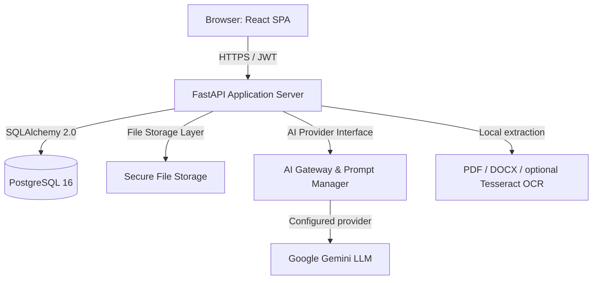

# Architecture Documentation — Candidate Dashboard AAIRO

## 1. System Overview

Aairo is designed as a decoupled, multi-tiered architecture consisting of:
1. **Frontend Presentation Layer**: Single Page Application (SPA) built with React 18, Vite, TypeScript, and Tailwind CSS.
2. **Backend API Gateway & Application Server**: High-performance RESTful API using Python 3.12, FastAPI, and Pydantic v2.
3. **Data Persistence Layer**: PostgreSQL 16+ relational database managed via SQLAlchemy 2.0 ORM and Alembic migrations.
4. **AI & Machine Learning Engine**: An extensible provider abstraction layer supporting Google Gemini with structured Pydantic schema validation, token tracking, timeouts, retries, and explicit unavailable/error states. Resume analysis does not return fabricated offline scores.
5. **Storage Subsystem**: Local secure disk storage abstraction with path sanitization, MIME verification, and SHA256 checksumming (ready for S3/MinIO cloud adaptation).

---

## 2. Component Design

### 2.1 Frontend Component Architecture
- **App Shell (`layouts/DashboardLayout.tsx`)**: Responsive sidebar with 12 navigation items, top header with search, notifications, and profile dropdown.
- **State Management**:
  - Server Cache & Fetching: `@tanstack/react-query`
  - Authentication State: React Context (`AuthContext`) with persistent JWT storage in localStorage/cookies.
  - Form Management: `react-hook-form` with `zod` schema resolvers.
- **Visual & UI Framework**:
  - Tailwind CSS with customized HSL tokens for primary, accent, neutral, and semantic states.
  - Lucide React icon set for consistent visual language.
  - Recharts for dashboard analytics and performance visualizations.

### 2.2 Backend Clean Architecture
- **`app/api/v1/`**: Versioned API endpoints separated by business domain. Route handlers perform request validation and delegate directly to service classes.
- **`app/services/`**: Encapsulates business logic, transactional workflows, access authorization checks, and orchestrates repository calls.
- **`app/repositories/`**: Handles database interactions, filtering, pagination, and queries using SQLAlchemy 2.0 select statements.
- **`app/models/`**: Declarative SQLAlchemy models with explicit relationships, cascading options, foreign keys, and indexes.
- **`app/schemas/`**: Pydantic v2 schemas for request validation and response serialization.
- **`app/integrations/ai/`**:
  - `base.py`: Abstract Base Class `AIProvider` defining interface for chat, structured generation, and evaluation.
  - `gemini_provider.py`: Google Gemini integration utilizing structured output schemas.
  - `provider_factory.py`: Instantiates configured providers and exposes unavailable state when credentials are missing.
  - `usage_tracker.py`: Records token consumption and latency metrics.

---

## 3. Security Architecture

1. **Authentication**:
   - Access tokens (JWT, 30 min expiration).
   - Refresh tokens (JWT, 7 days expiration).
   - Passwords hashed using `bcrypt` (work factor 12).
2. **Authorization (RBAC)**:
   - Three primary roles: `CANDIDATE`, `CONTENT_MANAGER`, `ADMINISTRATOR`.
   - Role-checking FastAPI dependencies (`get_current_active_user`, `require_role`).
3. **Data Isolation**:
   - All candidate queries filter explicitly by `user_id == current_user.id` or verify candidate profile ownership.
   - Resumes, assessments, mock interviews, and coach conversations are strictly partitioned per user.
4. **File Upload Security**:
   - Extension, declared MIME type, and file signature/content verification.
   - File extension whitelisting (`.pdf`, `.docx`, `.png`, `.jpg`, `.jpeg`).
   - Maximum upload limit enforced at 15MB.
   - Random UUID storage paths preventing path traversal attacks.
5. **CORS & Rate Limiting**:
   - Explicit CORS origin allowlist.
   - Candidate-scoped, PostgreSQL-backed fixed-window limits cover uploads (default 20/hour), extraction retries (20/hour), and analysis/enhancement (5/hour). Limits are configurable. Counters are atomic across app workers and reset by expiry; apply the current Alembic head before using the updated API.

## Resume processing details

- PDF text extraction uses pypdf; DOCX extraction uses python-docx. Image OCR requires the Tesseract executable and scanned-PDF OCR additionally requires PyMuPDF. Each scanned PDF page is rendered and OCRed independently; render dimensions are capped.
- Parsed data is persisted in PostgreSQL with original upload data and append-only version records. Analysis is marked completed only after configured provider output passes schema and source-grounding checks.
- Legacy analyses without provider evidence remain stored for audit, but a migration marks them unverified so the UI does not present them as validated results.
- AI suggestions must quote source text and supporting context; suggested content words must be present in the resume (grammatical function words may be added), and added numeric claims are rejected. AI extracted numeric fields are checked against source text.
- E2E tests use a separate database and temporary upload directory. The runner refuses the configured development database and never drops or resets the E2E database.

## Phase 4 implementation status

- Candidate question and learning-module screens use the versioned API. Candidate question serialization strips answer keys before practice; deterministic MCQ grading and provider-backed subjective evaluation have distinct result provenance. An unavailable subjective provider yields a null score while retaining the submitted answer.
- Content managers/admins can create questions into a pending-review queue, edit, approve/reject, and archive them. This is a limited question workflow; it is not full taxonomy administration or module/lesson CRUD.
- Module completion is derived from persisted per-lesson progress. Candidate reads and lesson completion are restricted to published modules matching candidate industry.
- Taxonomy management, question versioning, AI draft workflow, practice history, and full module user journeys are completely implemented.
