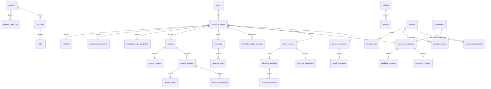

# Database Schema Documentation — Candidate Dashboard AAIRO

## Overview
PostgreSQL relational database schema designed with SQLAlchemy 2.0. Normalized across 30+ tables with primary key UUIDs, timestamps, strict foreign keys, and indexes on lookup columns.

---

## Entity Relationship Overview

---

## Detailed Table Specifications

### 1. Core Users & Profiles
- `users`: `id (UUID, PK)`, `email (VARCHAR 255, UNIQUE, INDEX)`, `hashed_password (VARCHAR 255)`, `full_name (VARCHAR 255)`, `role (ENUM: candidate, content_manager, administrator)`, `is_active (BOOLEAN)`, `is_verified (BOOLEAN)`, `created_at (TIMESTAMPTZ)`, `updated_at (TIMESTAMPTZ)`
- `candidate_profiles`: `id (UUID, PK)`, `user_id (UUID, FK -> users.id, UNIQUE)`, `candidate_type (VARCHAR: working_professional, student_fresher)`, `sub_category (VARCHAR)`, `industry_id (UUID, FK -> industries.id)`, `current_role (VARCHAR)`, `target_role (VARCHAR)`, `total_experience_months (INTEGER)`, `relevant_experience_months (INTEGER)`, `onboarding_completed (BOOLEAN)`, `onboarding_step (INTEGER)`, `interview_rounds_preferred (JSONB)`, `interaction_preference (VARCHAR: text, voice)`, `interview_readiness_score (FLOAT)`, `created_at`, `updated_at`
- `education`: `id (UUID, PK)`, `candidate_profile_id (UUID, FK -> candidate_profiles.id)`, `degree (VARCHAR)`, `field_of_study (VARCHAR)`, `institution (VARCHAR)`, `start_year (INTEGER)`, `end_year (INTEGER)`, `grade (VARCHAR)`, `is_current (BOOLEAN)`
- `professional_experience`: `id (UUID, PK)`, `candidate_profile_id (UUID, FK)`, `company_name (VARCHAR)`, `job_title (VARCHAR)`, `start_date (DATE)`, `end_date (DATE)`, `is_current (BOOLEAN)`, `description (TEXT)`
- `companies`: `id (UUID, PK)`, `name (VARCHAR 255, UNIQUE)`, `industry (VARCHAR)`, `logo_url (VARCHAR)`
- `candidate_target_companies`: `id (UUID, PK)`, `candidate_profile_id (UUID, FK)`, `company_id (UUID, FK -> companies.id)`, `target_role (VARCHAR)`

### 2. Taxonomy & Metadata
- `industries`: `id (UUID, PK)`, `name (VARCHAR 255, UNIQUE)`, `slug (VARCHAR, UNIQUE)`, `description (TEXT)`, `is_active (BOOLEAN)`
- `industry_categories`: `id (UUID, PK)`, `industry_id (UUID, FK -> industries.id)`, `name (VARCHAR 255)`
- `job_roles`: `id (UUID, PK)`, `industry_id (UUID, FK -> industries.id)`, `title (VARCHAR 255)`, `description (TEXT)`, `experience_level (VARCHAR)`
- `skills`: `id (UUID, PK)`, `name (VARCHAR 255, UNIQUE)`, `category (VARCHAR)`, `is_technical (BOOLEAN)`

### 3. Resume Engine
- `resumes`: `id (UUID, PK)`, `candidate_profile_id (UUID, FK)`, `file_name (VARCHAR)`, `file_path (VARCHAR)`, `file_size_bytes (INTEGER)`, `mime_type (VARCHAR)`, `sha256_hash (VARCHAR 64)`, `raw_text (TEXT)`, `parsed_data (JSONB)`, `created_at`, `updated_at`
- `resume_versions`: `id (UUID, PK)`, `resume_id (UUID, FK)`, `version_number (INTEGER)`, `content (JSONB)`, `created_at`
- `resume_analyses`: `id (UUID, PK)`, `resume_id (UUID, FK)`, `overall_score (FLOAT)`, `completeness_score (FLOAT)`, `skills_score (FLOAT)`, `experience_score (FLOAT)`, `target_role_alignment (FLOAT)`, `summary_analysis (TEXT)`, `missing_keywords (JSONB)`, `created_at`
- `resume_suggestions`: `id (UUID, PK)`, `resume_analysis_id (UUID, FK)`, `category (VARCHAR)`, `original_text (TEXT)`, `suggested_text (TEXT)`, `reason (TEXT)`, `status (ENUM: pending, accepted, rejected)`
- `resume_ats_reviews` (new migration `e8b51f0d7a42`): `id (UUID, PK)`, `resume_id (UUID, FK -> resumes.id, ON DELETE CASCADE)`, `job_title (VARCHAR 200)`, `job_description (TEXT)`, three deterministic 0–100 score fields, JSONB matched/missing job terms and section names, JSONB formatting warnings, and timestamps. Candidate access is verified via ownership of the linked resume.

### 4. Centralized Question Bank
- `questions`: `id (UUID, PK)`, `question_text (TEXT)`, `question_type (ENUM: mcq_single, mcq_multiple, short_answer, long_answer, descriptive, coding, scenario, case_study, situational, behavioral, technical, domain_specific)`, `industry_id (UUID, FK -> industries.id)`, `job_role_id (UUID, FK -> job_roles.id, NULLABLE)`, `subject (VARCHAR 255)`, `topic (VARCHAR 255)`, `difficulty (ENUM: beginner, intermediate, advanced, expert)`, `options (JSONB, NULLABLE for MCQs)`, `expected_answer (TEXT)`, `explanation (TEXT)`, `evaluation_rubric (JSONB)`, `tags (JSONB)`, `source_provenance (ENUM: source_verified, source_formatted, ai_generated, editorially_reviewed)`, `approval_status (ENUM: pending, approved, rejected)`, `created_at`, `updated_at`
- `question_bookmarks`: `id (UUID, PK)`, `candidate_profile_id (UUID, FK)`, `question_id (UUID, FK)`, `created_at`
- `question_practice_logs`: `id (UUID, PK)`, `candidate_profile_id (UUID, FK)`, `question_id (UUID, FK)`, `user_response (TEXT)`, `is_correct (BOOLEAN)`, `ai_feedback (TEXT)`, `created_at`

### 5. Learning Modules & Roadmaps
- `modules`: `id (UUID, PK)`, `industry_id (UUID, FK)`, `title (VARCHAR 255)`, `description (TEXT)`, `difficulty (VARCHAR)`, `duration_minutes (INTEGER)`, `order_index (INTEGER)`, `is_published (BOOLEAN)`
- `lessons`: `id (UUID, PK)`, `module_id (UUID, FK -> modules.id)`, `title (VARCHAR 255)`, `content (TEXT)`, `order_index (INTEGER)`
- `candidate_module_progress`: `id (UUID, PK)`, `candidate_profile_id (UUID, FK)`, `module_id (UUID, FK)`, `status (ENUM: not_started, in_progress, completed)`, `completion_percentage (FLOAT)`, `last_accessed_at (TIMESTAMPTZ)`
- `roadmaps`: `id (UUID, PK)`, `candidate_profile_id (UUID, FK)`, `title (VARCHAR 255)`, `description (TEXT)`, `status (VARCHAR)`, `created_at`
- `roadmap_tasks`: `id (UUID, PK)`, `roadmap_id (UUID, FK)`, `title (VARCHAR 255)`, `description (TEXT)`, `module_id (UUID, FK, NULLABLE)`, `order_index (INTEGER)`, `is_completed (BOOLEAN)`

### 6. Testing Engine
- `assessments`: `id (UUID, PK)`, `title (VARCHAR 255)`, `industry_id (UUID, FK)`, `job_role_id (UUID, FK, NULLABLE)`, `difficulty (VARCHAR)`, `duration_minutes (INTEGER)`, `total_questions (INTEGER)`, `passing_percentage (FLOAT)`
- `assessment_questions`: `id (UUID, PK)`, `assessment_id (UUID, FK)`, `question_id (UUID, FK)`, `order_index (INTEGER)`
- `assessment_attempts`: `id (UUID, PK)`, `assessment_id (UUID, FK)`, `candidate_profile_id (UUID, FK)`, `started_at (TIMESTAMPTZ)`, `completed_at (TIMESTAMPTZ)`, `status (ENUM: in_progress, completed, abandoned, timed_out)`, `time_spent_seconds (INTEGER)`
- `candidate_answers`: `id (UUID, PK)`, `assessment_attempt_id (UUID, FK)`, `question_id (UUID, FK)`, `selected_options (JSONB)`, `text_response (TEXT)`, `is_marked_for_review (BOOLEAN)`, `is_correct (BOOLEAN)`, `score_awarded (FLOAT)`, `feedback (TEXT)`
- `assessment_results`: `id (UUID, PK)`, `assessment_attempt_id (UUID, FK, UNIQUE)`, `total_score (FLOAT)`, `percentage (FLOAT)`, `passed (BOOLEAN)`, `correct_count (INTEGER)`, `incorrect_count (INTEGER)`, `unanswered_count (INTEGER)`, `topic_breakdown (JSONB)`, `difficulty_breakdown (JSONB)`, `recommendations (TEXT)`

### 7. AI Mock Interviews & Coach
- `mock_interviews`: `id (UUID, PK)`, `candidate_profile_id (UUID, FK)`, `industry_id (UUID, FK)`, `job_role (VARCHAR)`, `target_company (VARCHAR)`, `interview_round (VARCHAR)`, `difficulty (VARCHAR)`, `mode (VARCHAR: text, voice)`, `status (ENUM: setup, in_progress, completed, cancelled)`, `started_at`, `completed_at`
- `interview_questions`: `id (UUID, PK)`, `mock_interview_id (UUID, FK)`, `question_text (TEXT)`, `order_index (INTEGER)`, `is_follow_up (BOOLEAN)`, `parent_question_id (UUID, NULLABLE)`
- `interview_responses`: `id (UUID, PK)`, `interview_question_id (UUID, FK, UNIQUE)`, `candidate_answer (TEXT)`, `duration_seconds (INTEGER)`
- `interview_evaluations`: `id (UUID, PK)`, `mock_interview_id (UUID, FK, UNIQUE)`, `overall_score (FLOAT)`, `technical_score (FLOAT)`, `communication_score (FLOAT)`, `structure_score (FLOAT)`, `detailed_feedback (JSONB)`, `key_strengths (JSONB)`, `improvement_areas (JSONB)`
- `coach_conversations`: `id (UUID, PK)`, `candidate_profile_id (UUID, FK)`, `title (VARCHAR 255)`, `created_at`, `updated_at`
- `coach_messages`: `id (UUID, PK)`, `conversation_id (UUID, FK)`, `sender (ENUM: user, assistant, system)`, `message_text (TEXT)`, `metadata_payload (JSONB)`, `created_at`

### 8. Analytics & System
- `user_activity`: `id (UUID, PK)`, `user_id (UUID, FK)`, `action_type (VARCHAR)`, `entity_type (VARCHAR)`, `details (JSONB)`, `created_at`
- `notifications`: `id (UUID, PK)`, `user_id (UUID, FK)`, `title (VARCHAR 255)`, `message (TEXT)`, `type (VARCHAR)`, `is_read (BOOLEAN)`, `created_at`
- `audit_logs`: `id (UUID, PK)`, `user_id (UUID, FK, NULLABLE)`, `action (VARCHAR)`, `resource (VARCHAR)`, `ip_address (VARCHAR)`, `details (JSONB)`, `created_at`
