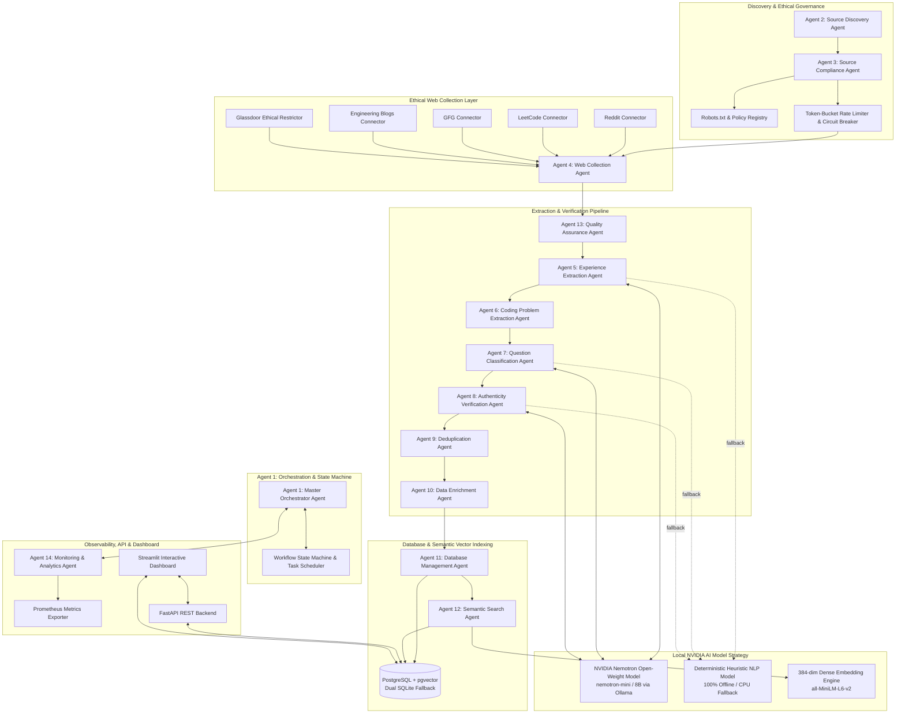

# 14-Agent System Architecture & Pipeline Specification

## 1. System Architecture Overview

## 2. The 14 Specialized Agents

| # | Agent Name | Technology | Operational Responsibility |
|---|---|---|---|
| **1** | **Master Orchestrator Agent** | Python / NeMo Agent State Machine | Manages task graph, dependencies, job lifecycle, fault recovery, and execution state. |
| **2** | **Source Discovery Agent** | Python / Scrapy Registry | Identifies public technical forums, engineering blogs, and authorized interview sources. |
| **3** | **Source Compliance Agent** | Python / RobotParser / Policy Engine | Validates `robots.txt`, enforces rate limits, rejects CAPTCHA/auth bypass, audits compliance. |
| **4** | **Web Collection Agent** | HTTPX Async / BeautifulSoup / Backoff | Concurrently fetches permitted content with token-bucket rate limiting and circuit breaking. |
| **5** | **Experience Extraction Agent** | NVIDIA Nemotron / Heuristic NLP | Extracts candidate role, experience level, rounds, question statements, and interview dates. |
| **6** | **Coding Problem Extraction Agent** | Python / Regex / Pydantic | Isolates problem statements, input/output formats, constraints, and test examples without fabricating data. |
| **7** | **Question Classification Agent** | Local Nemotron / Pattern Classifier | Classifies questions into 16 technical categories (DSA, Trees, DP, System Design, SQL, etc.) and difficulty. |
| **8** | **Authenticity Verification Agent** | Local AI / Experiential Heuristics | Distinguishes genuine first-person narratives from generic educational tutorials; scores confidence. |
| **9** | **Deduplication Agent** | SHA256 Hashing / Jaccard Similarity | Detects exact duplicates and near-duplicate variations while maintaining source attribution. |
| **10** | **Data Enrichment Agent** | Python / Normalization Maps | Standardizes company names, job titles, and extracts tech stack/skill tags. |
| **11** | **Database Management Agent** | SQLAlchemy / PostgreSQL / SQLite | Handles transactional persistence, foreign key relationships, and dual-engine compatibility. |
| **12** | **Semantic Search Agent** | Sentence Transformers (384-dim) / pgvector | Builds vector embeddings and performs cosine similarity search for natural language question queries. |
| **13** | **Quality Assurance Agent** | Pydantic v2 / Pytest | Validates document schemas, ensures non-null required attributes, and generates quality metrics. |
| **14** | **Monitoring & Analytics Agent** | Prometheus / Python Logging | Tracks processing latency, items collected, extracted, and duplicate counts. |

---

## 3. Database Schema (PostgreSQL + pgvector)

The relational model contains 14 tables:

1. `companies`: Company ID, name, canonical normalized name, industry, website, created timestamp.
2. `job_roles`: Role ID, standardized title, normalized title, department, experience tier.
3. `interview_experiences`: Experience ID, company foreign key, role foreign key, feedback, URL, content hash.
4. `interview_rounds`: Round ID, experience foreign key, round number, round type (OA, Tech 1, System Design, HR).
5. `interview_questions`: Question ID (UUID), company, role, text, category, difficulty, platform, URL, confidence, SHA256 content hash.
6. `question_categories`: Pre-seeded 16 technical and DSA categories.
7. `coding_problems`: Problem title, full statement, input/output specifications, constraints, examples JSON.
8. `data_sources`: Source name, base URL, collector type, active status.
9. `source_permissions`: Per-source compliance policy, rate limit RPS, robots.txt URL, policy audit notes.
10. `extraction_jobs`: Job ID, source name, status (PENDING, RUNNING, COMPLETED, FAILED), counts, errors.
11. `verification_results`: Question ID, first-person status, suspicion flag, confidence score, review status.
12. `duplicate_records`: Original question ID, duplicate ID, similarity score, duplicate type.
13. `agent_logs`: Agent name, execution ID, log level, message, metadata JSON.
14. `embeddings`: Question ID, model name (`all-MiniLM-L6-v2`), 384-dimensional dense vector (`pgvector`).
